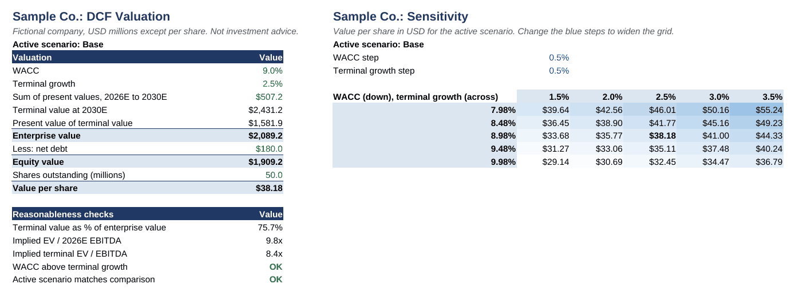

# DCF Valuation Model

A discounted cash flow model that estimates what a company is worth from its future cash flows. Python generates a formula-driven Excel workbook with three scenarios, a cost of capital build-up and a sensitivity grid.



**[Download the model](output/dcf_model.xlsx)**. Sample Co. and all its figures are fictional, and this project is not investment advice.

## Results

With a WACC of 8.98%, in USD:

| Scenario | Enterprise value | Value per share | Terminal value share of EV |
| --- | ---: | ---: | ---: |
| Base | $2,089m | $38.18 | 75.7% |
| Upside | $2,716m | $50.72 | 78.2% |
| Downside | $1,420m | $24.80 | 72.4% |

- **The range is wide.** The upside value per share is about twice the downside value, because growth and margins compound.
- **Most of the value sits beyond 2030.** Terminal value is over 70% of enterprise value in every scenario, so its assumptions deserve the most scrutiny.

## How the model works

1. **Forecast:** revenue growth and EBIT margin produce five years of unlevered free cash flow, after tax, D&A, capex and working capital.
2. **Discount rate:** cost of equity comes from the CAPM and is combined with after-tax cost of debt to give the WACC.
3. **Terminal value:** the Gordon growth method values cash flows beyond the forecast.
4. **Equity value:** present values give enterprise value, then net debt is deducted and the result is divided by shares.

## Workbook

| Sheet | Contents |
| --- | --- |
| Valuation | Result for the active scenario and reasonableness checks |
| Assumptions | All inputs, with a yellow cell to switch scenario |
| Forecast | Historical figures, projections and discounting |
| Scenarios | All three scenarios side by side |
| Sensitivity | Value per share across WACC and terminal growth |

Blue text marks inputs, black marks formulas and green marks links to other sheets.

## Limitations

- Cash flows are discounted at year end, and no mid-year convention is used.
- Terminal value uses final-year cash flow without separately normalising capex or working capital.
- A real valuation also needs market comparables and sourced company data.

## Run it

Requires Python 3.10 or later.

```bash
pip install -r requirements.txt
python -m dcf_model
pytest
```

Edit `data/assumptions.json` to value another company. Excel calculates the formulas when the file opens. If it opens in Protected View, select **Enable Editing**.

The tests recalculate the workbook with LibreOffice for every scenario and compare the results with a separate Python model. Those tests are skipped if LibreOffice is not installed.

## Built with

Python, openpyxl, pytest and Excel formulas.

## License

MIT
